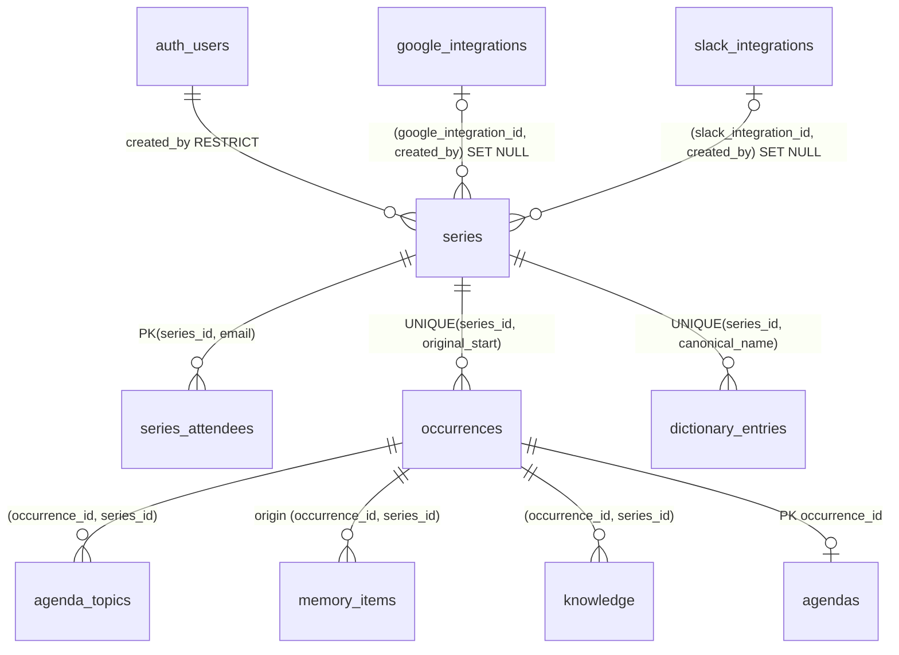

# 定例シリーズのチーム共有化 設計書

関連: [ADR-0008](../adr/ADR-0008-team-owned-meeting-series.md)（ADR-0004 を改訂し、ADR-0005 を置き換える）

## 概要

Shitaku.ai のデータの持ち主を「ユーザー」から「定例シリーズ」に変える。定例シリーズは Google カレンダーの繰り返し予定1つに対応する。シリーズの参加者は、作成者のカレンダーに載っている招待客から自動的に決まる。招待の操作はない。

参加者が得るもの:

- シリーズ内のすべての閲覧（回、議事録・ナレッジ、アジェンダ、チームメモリ、辞書、参加者一覧）
- 次回以降の回への議題の投稿と、自分の投稿の取り下げ
- アクションアイテムの状態の更新（完了、取り下げ、再オープン）

作成者だけができること: 設定、連携の選択、議事録の追加、メモリの抽出と編集、アジェンダの生成と編集、カレンダー同期、削除。

作成者の Google と Slack のトークンは参加者に見えない。共有されるのは、作成者が選んだ Slack チャンネル名と、作成者が選んで取り込んだトランスクリプトだけ。

## データモデル



| テーブル | 内容 | 書き手 |
|---|---|---|
| `series` | 1行 = 1つの iCalUID。`agents` と `recurring_meetings` を統合したもの | カレンダー由来の列はカレンダーミラー、設定列は作成者 |
| `series_attendees` | 作成者のカレンダーから見た招待客。小文字化したメール、表示名、主催者フラグ | カレンダーミラーのみ |
| `occurrences` | 回。識別子は Google の `originalStartTime`。`start_at` は日時変更に追従 | カレンダーミラーのみ |
| `agenda_topics` | 参加者が投稿した議題 | 参加者本人（作成者含む） |
| `memory_items` | 決定事項・アクションアイテム・未解決の論点。`kind` で区別し、種類ごとのルールは CHECK 制約で強制 | 作成者。参加者は解決状態のみ（RPC 経由） |
| `knowledge` | 回ごとの議事録。アップロードと、作成者が選んだ Meet トランスクリプト（旧 `meeting_transcripts` を統合） | 作成者 |
| `agendas` | 回ごとに1つのアジェンダ | 作成者 |
| `dictionary_entries` | シリーズごとの用語辞書 | 作成者 |

`google_integrations`、`slack_integrations`、`oauth_states` は個人の資格情報のまま変えない。

### シリーズの同一性

- シリーズは `ical_uid` で一意。カレンダーごとに異なりうるイベント `id` は、作成者のカレンダー上の位置を示す `creator_event_id` としてだけ持つ。
- 「この予定以降を変更」で分割された予定は iCalUID が変わるため、別シリーズになる。

### 回の同一性と持ち越し回数

- 回の識別子は `(series_id, original_start)`。日時を変更しても同じ回のまま。
- カレンダーミラーは同期のたびに前後35日の回を upsert する。回は削除しない。スナップショットの取得範囲（`window_start`〜`window_end`）にあるのにスナップショットに含まれない回は `is_cancelled = true` にする。作成者のカレンダーから予定が消えたら、未来の回をすべてキャンセル扱いにする。
- アクションアイテムと論点の持ち越し回数は保存しない。都度、次の条件をすべて満たす回 `o` の数として計算する。
  - キャンセルされていない
  - 起点の回より後、対象の回より前に始まる
  - 現在時刻より前に始まった
  - その時点で未解決だった（`closed_at` が null か、`o.start_at` より後）
- 一度閉じて再オープンした項目は、閉じていた期間も数える。35日を超えて同期が止まっていた期間は数え漏れる。どちらも許容する（Tradeoffs を参照）。

## 認可

### 参加者の定義は1か所だけ

`public.my_series_roles()`（SECURITY DEFINER、引数なし）が、呼び出したユーザーのロールを `(series_id, role)` で返す。すべての RLS ポリシーと API の権限チェックがこの関数を使う。

- `creator`: `series.created_by = auth.uid()`
- `member`: `series_attendees.email` が、呼び出し元の `auth.identities` 行のメールと一致する。その行は `provider = 'google'` で、`identity_data.email_verified = true` でなければならない。

`auth.users.email` と JWT の `email` クレームは信用しない。ローカル設定ではメールアドレスでのサインアップが確認なしで通るため。

### 二層防御

1. **アプリ層:** `member_access` / `creator_access` 依存関係が `my_series_roles()` を RPC で呼ぶ。結果は `MemberAccess` / `CreatorAccess` 型になり、作成者限定のユースケースは `CreatorAccess` しか受け取らない。リポジトリはすべての文で `series_id` を条件に入れる。権限がないときは 404（シリーズの存在自体を隠す）。参加者だが作成者でない場合は 403。
2. **DB層:** RLS が同じ `my_series_roles()` を評価する。

### 書き込み権限

| テーブル | SELECT | INSERT | UPDATE | DELETE |
|---|---|---|---|---|
| `series` | 参加者 | なし（ミラーのみ） | 作成者、設定列のみ（列単位 GRANT） | 作成者 |
| `series_attendees` | 参加者 | なし | なし | なし |
| `occurrences` | 参加者 | なし | なし | なし |
| `agenda_topics` | 参加者 | 参加者本人。未来の、キャンセルされていない回に限る | なし | 投稿者本人または作成者 |
| `memory_items` | 参加者 | 作成者 | 作成者 | 作成者 |
| `knowledge` | 参加者 | 作成者 | なし | 作成者 |
| `agendas` | 参加者 | 作成者 | 作成者 | 作成者 |
| `dictionary_entries` | 参加者 | 作成者 | 作成者 | 作成者 |
| `google_integrations` / `slack_integrations` / `oauth_states` | 本人のみ（変更なし） | | | |

参加者による解決状態の更新は `set_memory_item_resolution(item_id, resolution)`（SECURITY DEFINER）だけが行う。参加者が変更できるのはアクションアイテムだけ。決定事項と論点は作成者だけが変更できる。

### service role を使う場所

認証済み API で service role を使うのは、カレンダーミラーの `SeriesCalendarMirror`（`backend/src/infrastructure/external/series_calendar_mirror.py`）だけ。カレンダー由来のデータはすべてこのモジュールが書く。

- `claim(snapshot, creator_id, integration_id)`: 新しいシリーズを作成する。スナップショットは、呼び出し元自身の Google 連携で取得し、呼び出し元が参加者だと確認したもの。
- `apply(series_id, snapshot, fetched_at)`: 作成者のカレンダーから取得したスナップショットを反映する。`fetched_at` が `series.calendar_synced_at` より古ければ何もしない。これで、古い応答が新しい削除を上書きすることを防ぐ。
- `refresh_for_join(ical_uid)`: 新しく招待された人が参加するとき、作成者のカレンダーから招待客一覧を読み直す。2分以内に同期済みなら読み直さない。呼び出し元には何も返さない。参加できたかどうかは、その後に呼び出し元の JWT で RLS が判定する。

このほかの service role の利用は、既存の OAuth コールバックだけ。

### 資格情報

- `series.(google_integration_id, created_by)` は `google_integrations(id, user_id)` への複合外部キー。Slack も同じ。DB が「他人の連携を自分のシリーズに結び付けること」を拒否する。
- 連携を削除すると、シリーズ側の列が NULL になるだけでシリーズは残る。参加者の閲覧権は最後に同期した招待客一覧のまま続く。
- 作成者は設定画面で Google 連携を付け替えられる（切断して再接続した場合など）。付け替え先も複合外部キーで作成者本人の連携に限られる。
- トークンの復号と更新は `SeriesCredentials` だけが行い、トークンではなく API クライアントを返す。`get_all(user_id)[0]` で「最新の連携」を拾う書き方は廃止する。

## API

`/api/v1` 配下。「参加者」は作成者を含む。

| メソッドとパス | 権限 | リクエスト | レスポンス |
|---|---|---|---|
| `GET /series` | ログイン済み | — | `{ series: SeriesSummary[] }` |
| `GET /calendar/recurring-events?google_integration_id=` | 本人の連携 | — | `{ events: CalendarEventChoice[] }` |
| `POST /series` | ログイン済み | `ClaimRequest` | 201 `ClaimResponse`（created）、200（joined / already_member）。403 作成者の招待に含まれない、404 自分のカレンダーにない、409 作成者のカレンダーを読めない、422 この予定の参加者でない、または繰り返し予定でない |
| `GET /series/{sid}` | 参加者 | — | `SeriesDetail` |
| `PUT /series/{sid}/settings` | 作成者 | `SeriesSettingsRequest` | `SeriesDetail` |
| `POST /series/{sid}/calendar-sync` | 作成者 | — | `SeriesDetail` |
| `DELETE /series/{sid}` | 作成者 | — | 204 |
| `GET /series/{sid}/memory` | 参加者 | — | `TeamMemoryResponse` |
| `POST /series/{sid}/memory` | 作成者 | `NewMemoryRequest` | 201 `TeamMemoryResponse` |
| `PUT /series/{sid}/memory/{iid}` | 作成者 | `NewMemoryRequest`（同じ kind） | `TeamMemoryResponse` |
| `PUT /series/{sid}/memory/{iid}/resolution` | 参加者（アクションアイテム）、作成者（全種類） | `{ resolution: Resolution \| null }` | `TeamMemoryResponse` |
| `DELETE /series/{sid}/memory/{iid}` | 作成者 | — | `TeamMemoryResponse` |
| `GET /series/{sid}/occurrences/{oid}` | 参加者 | — | `OccurrenceDetail` |
| `POST /series/{sid}/occurrences/{oid}/topics` | 参加者 | `{ title, details? }` | 201 `AgendaTopic`。開始済みまたはキャンセル済みの回なら 422 |
| `DELETE /series/{sid}/topics/{tid}` | 投稿者または作成者 | — | 204 |
| `POST /series/{sid}/occurrences/{oid}/agenda` | 作成者 | — | `{ agenda: Agenda, sources: AgendaSources }` |
| `PUT /series/{sid}/occurrences/{oid}/agenda` | 作成者 | `{ content }` | `Agenda` |
| `GET /series/{sid}/occurrences/{oid}/transcript-candidates` | 作成者 | — | `{ candidates: TranscriptCandidate[] }` |
| `POST /series/{sid}/occurrences/{oid}/knowledge` | 作成者 | `AddKnowledgeRequest` | 201 `{ knowledge: KnowledgeSummary, normalization_warning: string \| null, replacement_count: number }` |
| `POST /series/{sid}/occurrences/{oid}/extract` | 作成者 | — | `ExtractionReport` |
| `GET /series/{sid}/knowledge/{kid}` | 参加者 | — | `Knowledge` |
| `DELETE /series/{sid}/knowledge/{kid}` | 作成者 | — | 204 |
| `GET /series/{sid}/dictionary` | 参加者 | — | `DictionaryEntry[]` |
| `POST /series/{sid}/dictionary` | 作成者 | `DictionaryEntryCreate` | 201 `DictionaryEntry` |
| `PUT` / `DELETE /series/{sid}/dictionary/{eid}` | 作成者 | `DictionaryEntryUpdate` | `DictionaryEntry` / 204 |

個人向けのルートは変更しない: `/google/{auth,callback,integrations,integrations/{id},auth/additional-scopes,sync-token}`、`/slack/{auth,callback,integrations,integrations/{id},integrations/{id}/channels}`、`/health`、`/health/services`。

廃止するルート: `/agents/**`、`/agendas/**`、`/knowledge/**`、`/dictionary/**`（ユーザー全体の辞書）、`/calendar/recurring*`、`/calendar/sync`、`/transcripts/**`、`/slack/integrations/{id}/channels/{cid}/messages`。

### レスポンス型（フロントエンドとの契約）

```ts
export type SeriesRole = 'creator' | 'member'
export type Resolution = 'reversed' | 'done' | 'dropped' | 'resolved'

export interface OccurrenceSummary {
  id: string
  start_at: string
  is_cancelled: boolean
  has_agenda: boolean
  knowledge_count: number
  topic_count: number
  needs_extraction: boolean
}
export interface SeriesSummary {
  id: string
  title: string
  role: SeriesRole
  next_occurrence: OccurrenceSummary | null
  open_action_items: number
  calendar_sync_error: string | null
}
export interface Attendee { email: string; display_name: string | null; is_organizer: boolean }
export interface SlackChannelRef { id: string; name: string }
export interface SeriesDetail {
  id: string
  title: string
  role: SeriesRole
  rrule: string | null
  attendees: Attendee[]
  occurrences: OccurrenceSummary[] // start_at 昇順
  settings: { description: string | null; minutes_count: number; slack_message_days: number }
  slack: { integration_id: string; channels: SlackChannelRef[] } | null
  calendar: { synced_at: string; error: string | null; google_connected: boolean; integration_id: string | null }
}
export interface CalendarEventChoice {
  calendar_event_id: string
  title: string
  rrule: string | null
  attendee_count: number
  series_id: string | null // 自分が見られるシリーズが既にあるときだけ入る
}
export interface ClaimRequest { google_integration_id: string; calendar_event_id: string }
export interface ClaimResponse { outcome: 'created' | 'joined' | 'already_member'; series: SeriesDetail }
export interface SeriesSettingsRequest {
  description: string | null
  minutes_count: number
  slack_message_days: number
  google_integration_id: string | null // 作成者自身の calendar.readonly 付きの連携。切断後の再接続に使う
  slack: { integration_id: string; channel_ids: string[] } | null
}

interface MemoryBase {
  id: string
  body: string
  origin_occurrence_id: string
  origin_start_at: string
  extracted: boolean
}
export type MemoryItem =
  | (MemoryBase & { kind: 'decision'; resolution: 'reversed' | null; closed_at: string | null })
  | (MemoryBase & {
      kind: 'action_item'
      assignee_email: string | null
      due_on: string | null
      resolution: 'done' | 'dropped' | null
      closed_at: string | null
      carry_over: number
    })
  | (MemoryBase & {
      kind: 'open_issue'
      resolution: 'resolved' | 'dropped' | null
      closed_at: string | null
      carry_over: number
    })
export interface TeamMemoryResponse { items: MemoryItem[] }
export type NewMemoryRequest =
  | { kind: 'decision'; body: string; origin_occurrence_id: string }
  | { kind: 'action_item'; body: string; origin_occurrence_id: string; assignee_email: string | null; due_on: string | null }
  | { kind: 'open_issue'; body: string; origin_occurrence_id: string }

export interface AgendaTopic {
  id: string
  title: string
  details: string | null
  author_label: string
  is_mine: boolean
  created_at: string
}
export interface Agenda { occurrence_id: string; content: string; generated_at: string; updated_at: string }
export interface KnowledgeSummary {
  id: string
  source: 'upload' | 'meet_transcript'
  title: string | null
  excerpt: string
  created_at: string
}
export interface Knowledge extends KnowledgeSummary { text: string }
export interface OccurrenceDetail {
  occurrence: OccurrenceSummary
  agenda: Agenda | null
  topics: AgendaTopic[]
  knowledge: KnowledgeSummary[]
}
export interface TranscriptCandidate { google_doc_id: string; name: string; created_at: string }
export type AddKnowledgeRequest =
  | { source: 'upload'; text: string }
  | { source: 'meet_transcript'; google_doc_id: string }
export interface AgendaSources {
  topics: number
  carried_action_items: number
  open_issues: number
  knowledge: number
  slack_messages: number
  slack_error: string | null    // not_connected | not_in_channel | rate_limited | slack_unavailable
  calendar_error: string | null // not_connected | scope_missing | revoked | attendees_omitted | event_not_found | calendar_unavailable
  proposal_error: 'llm_unavailable' | null // LLM の提案部分だけが失敗した。必須セクションは作成済み
  truncated: boolean // 入力の上限を超え、議事録や Slack の一部を省いた
}
export interface ExtractionReport {
  created: number
  closed: number
  truncated: boolean
  items: MemoryItem[]
}
export interface DictionaryEntry {
  id: string
  canonical_name: string
  category: 'person' | 'project' | 'term' | 'customer' | 'abbreviation' | null
  aliases: string[]
  description: string | null
}
export type DictionaryEntryCreate = Omit<DictionaryEntry, 'id'>
export type DictionaryEntryUpdate = Partial<DictionaryEntryCreate>
```

## 主な流れ

### シリーズを追加する（claim または join）

1. 呼び出し元が自分の Google 連携を選び、`GET /calendar/recurring-events` で自分のカレンダーの繰り返し予定を見る。
2. `POST /series` で予定を選ぶ。バックエンドは呼び出し元自身のカレンダーから予定を読み、呼び出し元の Google 確認済みメールが主催者か招待客に含まれることを確かめる。含まれなければ 422。
3. その iCalUID のシリーズがなければ、`SeriesCalendarMirror.claim` で呼び出し元を作成者として作り、スナップショットを反映する。結果は created。
4. 呼び出し元の JWT でそのシリーズが見えれば already_member。
5. 見えなければ `refresh_for_join` で作成者のカレンダーから招待客一覧を読み直し、もう一度呼び出し元の JWT で確かめる。見えれば joined、見えなければ 403。

参加者を決めるのは作成者のカレンダーだけ。参加しようとする人のカレンダーは `events.import` で偽造できるので、権限の根拠にしない。

### 会議の後: 議事録とメモリ抽出

1. 作成者がアップロードするか、トランスクリプトの候補から選ぶ（`POST …/knowledge`）。候補は作成者の Drive からその都度読み、回の開始1時間前から24時間後までに作られた「Meet Recordings」のドキュメントに絞る。選ばれなかった候補は DB に保存しない。
2. クライアントは続けて `POST …/extract` を呼ぶ。バックエンドは Bedrock の tool use を1回呼び、結果を境界でパースしてから、`apply_extraction` で1トランザクションにまとめて反映する。
   - 抽出された項目には `extraction_key`（kind と本文から作るハッシュ）を付け、`(origin_occurrence_id, extraction_key)` を一意にする。同じ結果を再実行しても重複しない。
   - 再抽出は追加のみで、既存の項目を削除しない。同じキーの項目が人に触られておらず未解決なら、担当者と期限だけを更新する。
   - LLM が「解決した」と判断した既存項目を閉じるのは、人が触っていない項目だけ。
   - LLM の出力に不正な要素が1つでもあれば、何も変えずに 502 を返す。
   - `occurrences.extracted_at` には、抽出の入力を読んだ時刻を入れる。それより古い入力の抽出結果が後から届いたら、何も変えずに 409 を返す。
   - 入力が文字数の上限を超えたら、議事録だけを切り詰め、レスポンスの `truncated: true` で知らせる。既存項目の一覧（未解決のアクションと論点、最新20件の決定事項）は切り詰めない。それだけで上限を超えるときは 413。
3. 抽出し損ねた回は `needs_extraction`（最新の議事録の時刻 > `extracted_at`）で一覧に表示され、作成者が再実行できる。

### 会議の前: アジェンダ生成

作成者が `POST …/agenda` を呼ぶ。アジェンダの必須セクションはコードが組み立てる。LLM が書くのは提案部分だけなので、投稿された議題などを LLM が落とすことはない。

```markdown
## 事前に投稿された議題
- {title}（{author_label}）: {details}
## 持ち越しのアクションアイテム
- {body}（担当: {assignee_email}、期限: {due_on}）: {carry_over}回持ち越し
## 未解決の論点
- {body}: {carry_over}回持ち越し
## 議論の提案
{LLM の出力}
```

- 担当と期限は、値があるものだけを括弧に入れる。両方ないときは括弧ごと省く。
- 議題の改行は空白にまとめ、参加者が見出しを差し込めないようにする。
- `author_label` は DB のトリガーが、投稿者の Google 確認済みメールに一致する `series_attendees.display_name`（なければメールアドレス）から決める。利用者は指定できない。
- LLM への入力は1つの上限で切り詰め、超えたら `AgendaSources.truncated` で知らせる。LLM が失敗したら提案部分を空にして `proposal_error` で知らせる。

LLM への入力には、上の各項目に加え、最近の決定事項、直前までの回の議事録（新しい順に `minutes_count` 件）、選んだ Slack チャンネルの直前の回以降のメッセージ（最新100件）、シリーズの辞書を含める。

## 既存データの移行

- 移行するのは置き場所だけ。旧テーブル `agents`、`recurring_meetings`、`meeting_transcripts`、`knowledge`、`agendas`、`dictionary_entries` を `legacy` スキーマへ移す。PostgREST では公開しないが、ロールバック用に残す。
- 中身は新しいシリーズへ自動ではコピーしない。旧データは各ユーザーの非公開データで、自動でコピーすると参加者にも見えてしまうため。利用者はシリーズを claim し直し、必要な議事録を追加し直す。
- `generated_agendas` と `slack_messages` は書き手も読み手もいないので削除する。
- 新しい形で問題ないと運用者が確認したら、別のマイグレーションで `legacy` スキーマを削除する。
- ロールバックの手順: 新しいテーブル・関数・ビューを削除し、`legacy` のテーブルを `public` に戻し、旧バックエンドとフロントエンドをデプロイし直す。

## 検証

| 対象 | 方法 |
|---|---|
| 認可 | `make test-rls`。ローカルの Supabase に実ユーザーを作り、実 JWT を使う（`backend/tests/rls/`）。登場人物は A＝作成者、B＝Google 確認済みの招待客、C＝部外者、D＝メールアドレスでだけ B のアドレスを名乗るユーザー、E＝Google だが未確認の招待客。全テーブル・全 RPC で、閲覧、書き込み、他人になりすました書き込み、資格情報の読み取りを確かめる |
| 抽出 | 同じ結果の再適用で重複しないこと、人が触った項目が保護されること、抽出中に追加された議事録が未抽出として残ること |
| アジェンダ | LLM の出力が空でも、必須セクションに全項目が含まれること |
| 画面 | ローカルで backend と frontend を起動し、B としてログインして議題を投稿する。A がアジェンダを生成すると、その議題と持ち越しのアクションアイテムが含まれること。Bedrock はローカルのスタブサーバーを `AWS_BEDROCK_ENDPOINT` で指す |

## Tradeoffs

- ADR-0005 の「複数の定例をまたいだ集約」をやめる。代わりに、シリーズごとに参加者が1組に決まり、シリーズ間で情報が漏れない。
- 参加者を読み取り時に計算する。代わりに、招待待ちの状態も、同期ジョブも、GoTrue のテーブルへのトリガーも要らない。
- カレンダー由来のデータを書く service role の経路を1モジュールに置く。代わりに、作成者が直接 SQL で招待客一覧や iCalUID を書き換えることはできない。
- 参加者はアジェンダの生成も議事録の追加もできない。代わりに、作成者の資格情報を他人の操作で使うのは、招待客一覧の読み直しだけになる。
- 抽出はクライアントが続けて呼ぶ別リクエストにする。代わりに、リクエスト時間に上限があり、バックグラウンド基盤を足さずに済む。
- 持ち越し回数は `closed_at` 1列から計算する。代わりに、状態の履歴テーブルを持たない。再オープンした項目は、閉じていた期間も数える。
- 旧データを自動では共有しない。代わりに、利用者は claim と議事録の追加をやり直す必要がある。
- 作成者が Google 連携を外しても、参加者の閲覧権は最後の同期のまま残る。作成者は止めたければシリーズを削除する。

## 検討した代替案

- **エージェントを残して、その下に複数のシリーズを持たせる。** シリーズごとに参加者が違うと、エージェント単位の議事録や辞書を誰に見せるか決められない。和集合を取れば漏れ、積集合を取れば分かりにくい。
- **参加者を保存するテーブルを持ち、トリガーで同期する。** 正しさの根拠が2か所になり、GoTrue のテーブルへのトリガーと招待待ちの状態が必要になる。
- **JWT の email と provider クレームを RLS で信用する。** メールアドレスでのサインアップが確認なしで通る設定だと偽装できる。
- **処理の台帳（リース、チェックポイント、提案キュー）を持つ汎用の非同期処理。** 5〜10人の検証段階では、1人で保守できる量を超える。
- **決定・アクション・論点を別テーブルにする。** 1つのライフサイクルなのに、RLS、抽出、持ち越しの処理を3回書くことになる。

## 未解決の論点

1. 本番の Supabase Auth で、メールアドレスでのサインアップを無効にしているか（Google のみか）。有効だと、Google ログインより前に同じアドレスを登録されたときのアカウント乗っ取りの経路になりうる。
2. 同じ繰り返し予定の iCalUID が、参加者全員のカレンダーで一致するか。実際のアカウント2つで確認する。
3. Google グループや別名アドレスで招待された人は、Google のメールと一致せず参加できない。「個人のアドレスで招待する」という運用で問題ないか。
4. 作成者が抜けるときの引き継ぎ。今は作成者のアカウント削除を `ON DELETE RESTRICT` で止める。
5. 偽の予定で iCalUID を先に claim された場合の復旧は、管理者が SQL で行う。
